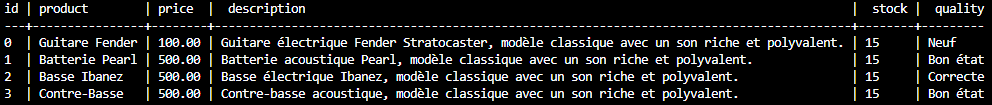

# Rackeur

**Rackeur** est une application de gestion d'un catalogue de matériel destiné aux concerts et aux événements.

Elle permet de consulter, rechercher et gérer un catalogue de produits à travers une interface graphique. Un panneau d'administration permet aux gestionnaires et aux éditeurs de gérer les produits et les utilisateurs, selon leurs permissions.



---

## Sommaire

- [Fonctionnalités](#fonctionnalités)
- [Technologies](#technologies)
- [Installation et configuration](#installation-et-configuration)
    - [Prérequis](#prérequis)
    - [Compatibilité](#compatibilité)
    - [Installation](#installation)
    - [Données de démonstration](#données-de-démonstration)
    - [Administration](#administration)
- [Arborescence](#arborescence)
- [Équipe](#équipe)
- [Crédits et dépendances](#crédits-et-dépendances)
- [Licence](#licence)

---

## Fonctionnalités

### Catalogue de produits
- Consultation du catalogue et des informations associées aux produits.
- Recherche de produits par mots-clés.
- Tri des produits par nom et par prix.

### Gestion et administration
- Création et authentification des comptes utilisateurs.
- Gestion des produits : ajout, modification et suppression.
- Gestion des utilisateurs et de leurs permissions.
- Interface d'administration adaptée aux droits de chaque utilisateur.

### Sécurité
- Application du principe du moindre privilège (*Principle of Least Privilege*, PoLP).
- Hachage des mots de passe avec bcrypt.
- Vérification des mots de passe compromis lors de l'inscription et de l'authentification, grâce à l'API Have I Been Pwned.
- Notifications en cas de détection de nouveaux compromis.

### Stockage des données
- Prise en charge de deux formats de stockage : CSV et SQLite.
- Possibilité de choisir le type de base de données au démarrage.

---

## Technologies

| Technologie   | Utilisation                        |
|---------------|------------------------------------|
| Python 3.15.0 | Langage de programmation           |
| PyQt6         | Interface graphique                |
| CSV           | Stockage des données au format CSV |
| SQLite        | Gestion de la base de données      |
| bcrypt        | Hachage des mots de passe          |
| Requests      | Requêtes HTTP vers les API         |

---

## Installation et configuration

### Prérequis

Les outils suivants sont nécessaires pour installer et exécuter le projet.

| Outil         | Utilisation                | Téléchargement                                  |
|---------------|----------------------------|-------------------------------------------------|
| Python 3.15.0 | Exécution de l'application | [python.org](https://www.python.org/downloads/) |
| Git           | Récupération du dépôt      | [git-scm.com](https://git-scm.com/downloads)    |

### Compatibilité

Environnement actuellement testé :

| Composant              | Version         |
|------------------------|-----------------|
| Système d'exploitation | Windows 11 26H2 |
| Python                 | 3.15.0          |

D'autres environnements peuvent fonctionner, mais n'ont pas nécessairement été testés.

### Installation

1. **Cloner le dépôt GitHub** dans le dossier de votre choix :

   ```bash
   git clone https://github.com/Hellebore-jpg/rackeur.git
   cd rackeur
   ```

2. **Créer un environnement virtuel Python** :

   ```bash
   python -m venv .venv
   ```

3. **Activer l'environnement virtuel** :

   Sous Windows (PowerShell) :

   ```powershell
   .venv\Scripts\Activate.ps1
   ```

   Sous Linux / macOS :

   ```bash
   source .venv/bin/activate
   ```

4. **Installer les dépendances** :

   ```bash
   pip install -r requirements.txt
   ```

5. **Lancer l'application** :

   ```bash
   python app.py
   ```

### Données de démonstration

Il est possible d'installer un jeu de données de test afin de découvrir l'application avec un catalogue prérempli.

> **Attention :** cette opération peut remplacer les données existantes. Pensez à sauvegarder vos fichiers avant de procéder.

1. Renommer `assets/data/test_catalogue.csv` en `assets/data/catalogue.csv`.
2. Exécuter le script `sqlite_test_db_maker.py` afin de générer une base de données SQLite contenant les données de démonstration.
3. Démarrer l'application et sélectionner le format de base de données correspondant.

Les données de démonstration sont facultatives. Vous pouvez utiliser l'application sans les installer.

### Administration

Le panneau d'administration est accessible aux utilisateurs disposant des permissions appropriées, notamment les administrateurs et les éditeurs.

Les fonctionnalités disponibles dans ce panneau dépendent des autorisations attribuées à chaque utilisateur, conformément au principe du moindre privilège.

#### Comptes de démonstration

> Notez que ces 2 utilisateurs sont automatiquement créés si la base de données utilisateurs n'existe pas.

| Nom d'utilisateur | Mot de passe | Rôle           |
|-------------------|--------------|----------------|
| `admin`           | `123456789`  | Administrateur |
| `editor`          | `123456789`  | Éditeur        |

> **Avertissement :** ces identifiants sont exclusivement destinés aux tests. Ne les utilisez jamais dans un environnement réel et remplacez-les avant toute utilisation en dehors d'un environnement de démonstration.

---

## Arborescence

```text
rackeur/
├── assets/                     # Ressources de l'application
│   ├── data/                   # Bases de données et fichiers de données
│   │   ├── catalogue.csv       # Catalogue au format CSV
│   │   ├── catalogue.db        # Catalogue au format SQLite
│   │   ├── utilisateurs.csv    # Utilisateurs au format CSV
│   │   └── utilisateurs.db     # Utilisateurs au format SQLite
│   │
│   ├── font/                   # Polices de caractères
│   ├── img/                    # Images et icônes
│   └── style.qss               # Feuille de style PyQt
│
├── src/                        # Code source Python
│   ├── ui/                     # Interfaces et fenêtres PyQt
│   ├── utils/                  # Modules et fonctions utilitaires
│   └── config.py               # Configuration globale
│
├── app.py                      # Point d'entrée de l'application
├── requirements.txt            # Dépendances Python
├── README.md                   # Documentation du projet
└── TODO.md                     # Backlog et suivi du projet
```

---

## Équipe

Projet réalisé par quatre collaborateurs dans le cadre du module **Développement Sécurisé** à **Guardia CS**, en 2026.

| Collaborateur | Rôle           | GitHub                                               |
|---------------|----------------|------------------------------------------------------|
| Mathieu       | Chef de projet | [@Hellebore-jpg](https://github.com/Hellebore-jpg)   |
| Charles       | Communication  | [@chummel-ops](https://github.com/chummel-ops)       |
| Yanis         | Développement  | [@ylavallee-prog](https://github.com/ylavallee-prog) |
| Gabriel       | Développement  | [@Purple-key-0](https://github.com/Purple-key-0)     |

---

## Crédits et dépendances

Ce projet utilise plusieurs bibliothèques et services externes :

| Dépendance        | Utilisation                              | Documentation                                                |
|-------------------|------------------------------------------|--------------------------------------------------------------|
| PyQt6             | Interface graphique                      | [Documentation PyQt6](https://pypi.org/project/PyQt6/)       |
| Requests          | Requêtes HTTP                            | [Documentation Requests](https://pypi.org/project/requests/) |
| bcrypt            | Hachage des mots de passe                | [Documentation bcrypt](https://pypi.org/project/bcrypt/)     |
| Have I Been Pwned | Vérification des mots de passe compromis | [Documentation API](https://haveibeenpwned.com/API/v3)       |

---

## Licence

Ce projet est distribué sous licence **GNU General Public License v3.0 (GPL-3.0)**.

Consultez le fichier [LICENSE](LICENSE) pour accéder au texte intégral de la licence.